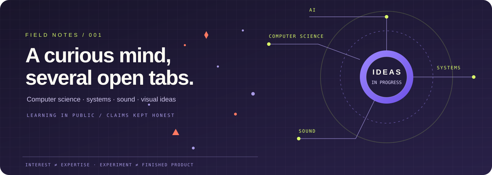
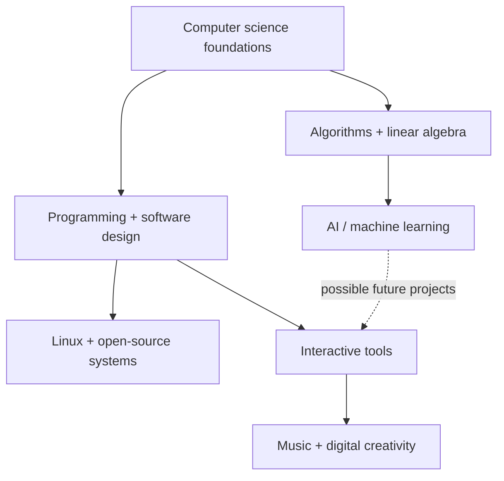

# SHAHIN ARAB / FIELD NOTES

### Computer Engineering · Curious systems · Computational creativity

*Currently learning. Frequently experimenting. Not pretending that interests are credentials.*

---

> **A note on the signal-to-noise ratio:** this is a student profile, not a fictional career page. I’m building foundations, following questions, and trying to turn some of those questions into useful work. The goal is to show the trail honestly, including the unfinished bits.

## ⌁ Table of contents

| | |
|---|---|
| [01 · The short version](#-01--the-short-version) | [04 · Current learning](#-04--current-learning) |
| [02 · Interest constellation](#-02--interest-constellation) | [05 · Off-screen interests](#-05--off-screen-interests) |
| [03 · The kind of questions](#-03--the-kind-of-questions) | [06 · The repository rule](#-06--the-repository-rule) |

## ◉ 01 · The short version

I’m an undergraduate **Computer Engineering student** based in Shiraz, Iran. My current coursework includes linear algebra and fundamentals of algorithms. Outside class, I’m learning programming and web development while exploring the bigger landscape around AI, computer systems, and creative technology.

**Education:** Computer Engineering at Zand Institute of Higher Education, Shiraz, Iran · *in progress.*

My working interests are broader than my current skill level. I prefer to label the difference rather than blur it.

| Signal | What it means here |
|:---|:---|
| **Learning** | Topics I’m actively trying to understand, not subjects I claim to have mastered. |
| **Experimenting** | Small attempts, prototypes, coursework, and ideas that may change or be abandoned. |
| **Creative practice** | Music production, sound design, visual aesthetics, and digital art. |
| **Longer horizon** | Strong computer-science fundamentals, useful open-source work, and international academic opportunities. |

## ⌘ 02 · Interest constellation

| Domain | Pulling me in | The questions underneath |
|---|---|---|
| **Artificial intelligence** | AI systems, machine learning, tools built around models | What makes a system useful, reliable, and worth trusting? |
| **Computer science** | Algorithms, data structures, linear algebra, software design | Can I explain why something works, not just get it to run? |
| **Systems & open source** | Linux, virtualization, developer tools | How does the machinery behave when the abstractions stop helping? |
| **Human + machine** | Interfaces, computational creativity, music software | How can technology give people more room to make things? |

<strong>Open the map as a study plan</strong> · a direction, not a promise

The interests below are connected, but not interchangeable. Foundations come first; projects should follow the understanding, rather than the other way around.

## ◌ 03 · The kind of questions

<strong>AI & reliability</strong>

- How should AI-powered tools handle uncertainty, failure, and limited resources?
- What is the smallest implementation that can test an idea honestly?
- How do you distinguish a convincing demo from a dependable system?

<strong>Algorithms & fundamentals</strong>

- What is the cost of an algorithm as input size grows?
- Which mathematical idea makes a programming technique click?
- Can I explain a solution in plain language before translating it into code?

<strong>Creative technology</strong>

- What can software reveal about sound, rhythm, and visual patterns?
- How can interfaces feel expressive without becoming difficult to use?
- What happens when art direction and engineering constraints meet?

## 📚 04 · Current learning

| Track | Current focus | Evidence I want to build |
|---|---|---|
| **Coursework** | Linear algebra and fundamentals of algorithms | Clear notes, worked examples, and accurate explanations |
| **Programming** | Strengthening fundamentals and web development | Small, understandable projects with instructions that work |
| **Systems** | Linux and virtualization | Better mental models and repeatable experiments |
| **AI** | Understanding the field and how AI tools are put together | Reading notes, comparisons, and careful prototypes |

<strong>Learning log · what counts as progress?</strong>

- [ ] Explain a difficult concept without copying the textbook.
- [ ] Complete a small project from start to finish.
- [ ] Document setup, limitations, and reproducible steps.
- [ ] Separate measured results from guesses.
- [ ] Revisit old work and record what changed in my understanding.

*This is a checklist of standards I want to work toward, not a claim that they are all completed.*

## 🎛 05 · Off-screen interests

| Side of life | Things I’m into |
|---|---|
| **Making sound** | FL Studio, Ableton Live, music production, arrangement, and sound design |
| **Listening** | Electronic music, progressive rock, nu-metal, jazz, rap, and Iranian music |
| **Visuals** | Digital art, strong color systems, interface design, and strange little visual ideas |
| **Digital tinkering** | Linux, virtual machines, operating systems, and figuring out how tools fit together |
| **Local history & culture** | Shiraz, Persian cultural history, and the way place shapes art |

<blockquote>
  
<strong>Creative rule:</strong> listen widely, keep experimenting, finish more small things, and don’t mistake having a taste for having a finished body of work.

</blockquote>

## ⟁ 06 · The repository rule

This GitHub account is a **workbench**, not a list of finished products. It contains coursework, experiments, prototypes, archived ideas, and work in progress.

- Repository language labels are GitHub metadata, not proof of proficiency.
- A repository name or polished interface does not establish that the code is complete.
- An experiment may be useful even if it is never shipped.
- Completed work should eventually have a reproducible setup, a clear README, known limitations, and evidence that it runs.

<strong>What I want every serious project to eventually contain</strong>

1. A clear problem statement and a limited scope.
2. A README that says what works and what does not.
3. Reproduction steps that a stranger can follow.
4. Tests or demonstrations appropriate to the project.
5. Honest limitations, known issues, and next steps.

---

### Curiosity is the starting point. Finished work is the evidence.

*Shahin Arab · Shiraz, Iran · Updated October 2026*

[Explore the repository list →](https://github.com/Shaiinarab?tab=repositories) · [Open the site →](https://shaiinarab.github.io/shaiinarab/)

