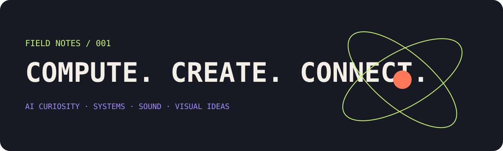
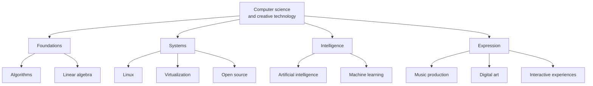

# Shahin Arab

### Computer Engineering · AI curiosity · systems · sound · visual ideas

*An evolving field journal for things I’m trying to understand, make, and connect.*

> [!NOTE]
> **Calibration before the lore:** I’m a student still building my foundations, not an established engineer or researcher. This is a map of interests, current learning, and hobbies, not a catalogue of invented credentials. The internet has enough of those already.

---

## 00 / Index

| Coordinates | Section | What lives there |
|:--|:--|:--|
| <code>01</code> | [The short version](#-01--the-short-version) | Who I am, without the mythology |
| <code>02</code> | [Curiosity map](#-02--curiosity-map) | Subjects that keep pulling me in |
| <code>03</code> | [Current learning](#-03--current-learning) | What I’m studying now |
| <code>04</code> | [Outside the IDE](#-04--outside-the-ide) | Music, art, and other human things |
| <code>05</code> | [Repositories](#-05--repositories-are-not-trophies) | Coursework, experiments, unfinished ideas |
| <code>06</code> | [The long arc](#-06--the-long-arc) | Where I’d like learning to lead |

## ✳ 01 / The short version

I’m Shahin, a Computer Engineering undergraduate based in Shiraz, Iran. I’m fascinated by the logic underneath software, the strange capabilities of AI, the freedom of open systems, and the ways computers can become creative instruments.

My goal for now is deliberately unglamorous: **learn the fundamentals, follow my curiosity, finish small things, and keep a record that reflects reality.**

<strong>Compact academic snapshot</strong> · expand

| Field | Current picture |
|:--|:--|
| Education | Computer Engineering undergraduate at Zand Institute of Higher Education |
| Current coursework | Linear algebra; fundamentals of algorithms |
| Learning outside class | Programming fundamentals and web development |
| Languages I use to communicate | Persian and English |
| Direction of interest | AI, computer science foundations, systems, and creative technology |

*No degree date, GPA, publication list, job title, or proficiency level is implied by this snapshot.*

## ⌘ 02 / Curiosity map

These are **areas of interest**, not claims that I have mastered each field.

| Orbit | Questions I find interesting | Current relationship |
|:--|:--|:--|
| 🧠 **AI & machine learning** | How do models learn, how should they be evaluated, and where do they actually help? | Exploring concepts and tools |
| ∑ **Algorithms & mathematics** | How can a problem be represented clearly, and how do we reason about complexity? | Coursework and practice |
| 🐧 **Linux & open systems** | How do operating systems, virtual machines, and developer tools fit together? | Long-running personal interest |
| 🧩 **Software design** | What makes a system understandable, reliable, and useful to another person? | Learning by examining and experimenting |
| 🎛️ **Computational creativity** | How can software interact with music, sound, visuals, and human expression? | Creative curiosity |

### A rough map of how these interests connect

<strong>Why this combination?</strong>

I like following connections between subjects that are often kept in separate boxes. Mathematics helps explain algorithms; systems work gives software a place to run; AI raises questions about data and evaluation; music and art make me think about tools from the perspective of the person using them.

That does not make me an expert in all four. It makes them a useful compass for what to learn next.

## ⌁ 03 / Current learning

The active chapter is about foundations, not collecting impressive technology names.

- [ ] Build a more dependable understanding of linear algebra.
- [ ] Get comfortable analysing algorithms and their complexity.
- [ ] Keep improving programming fundamentals through small exercises.
- [ ] Continue learning web development and the basic pieces of a web application.
- [ ] Document mistakes and useful discoveries, not just polished outcomes.

<strong>My rule for learning projects</strong>

A small, finished program that I can explain is more valuable than a giant repository whose architecture I cannot defend.

When I publish meaningful work, I want each project to answer four questions:

1. What problem was I trying to understand or solve?
2. What does the code actually do today?
3. What did I learn, including the parts that went wrong?
4. What remains unfinished?

## ♪ 04 / Outside the IDE

Computers are not my only interest. The offline part of this profile is not an afterthought.

| Soundtrack | Creative tools | Visual interests |
|:--|:--|:--|
| Electronic music | FL Studio | Digital art |
| Progressive rock | Ableton Live | Interface aesthetics |
| Nu-metal & rap | Arrangement and sound design | Generative and interactive visuals |
| Jazz & Iranian music | Listening, experimenting, learning | Art × technology |

My listening habits jump between loud guitars, electronic textures, rap, jazz, and Iranian music. I enjoy music production as a hobby: arranging sounds, experimenting with effects, and learning how a musical idea changes when you actually build it.

I’m also interested in digital art, visual systems, and the design of tools that feel enjoyable to use.

> *A computer can be a laboratory, a musical instrument, a sketchbook, or an unnecessarily complicated way to make a list. Context matters.*

## ⌘ 05 / Repositories are not trophies

[**Browse all public repositories →**](https://github.com/Shaiinarab?tab=repositories)

This account contains a mixture of coursework, experiments, prototypes, and ideas at different stages. A repository being public does **not** mean it is complete, production-ready, independently authored in every part, or evidence of professional proficiency.

I want the repository history to become a record of learning: clearer READMEs, smaller scopes, reproducible steps, and honest descriptions of what works.

<strong>How to read my repository list</strong>

- **Coursework** means a learning exercise, not a claim of mastery.
- **Experiment** means I’m exploring an idea; interfaces and implementations may change.
- **Archived** means the repository is archived on GitHub or no longer active.
- **In progress** means unfinished. Please do not mentally promote it to production software.

The project README and commit history are the evidence. The profile page is just a map.

## ↗ 06 / The long arc

I’d like to build solid computer science knowledge, contribute useful work to open source, explore AI and creative software more deeply, and eventually pursue international academic opportunities.

That future is a direction, not an achievement badge.

### Learn deeply. Build honestly. Stay curious.

[GitHub repositories](https://github.com/Shaiinarab?tab=repositories) · [Profile website](https://shaiinarab.github.io/shaiinarab/) · [LinkedIn](https://www.linkedin.com/in/shaiinarab/) · [Hugging Face](https://huggingface.co/shahinozone)

Last manually reviewed: October 2026 · Interests change; claims should change only when the evidence does.

---

† This profile intentionally prioritizes interests and current learning over a skills inventory. I’ll add concrete projects and stronger claims when there is work to support them.
